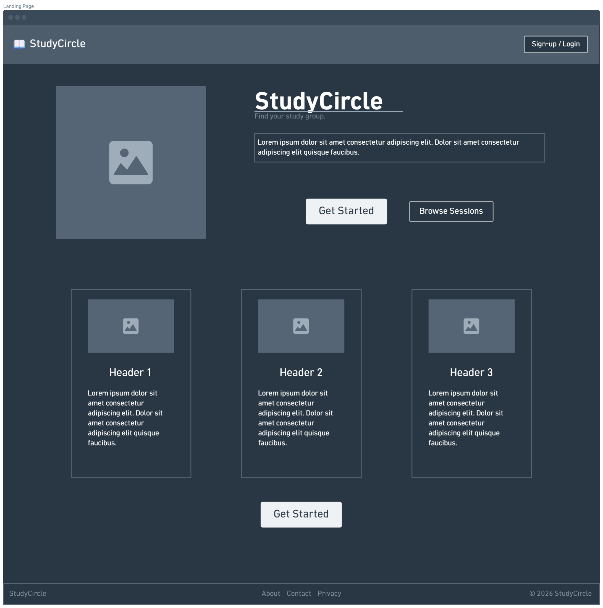
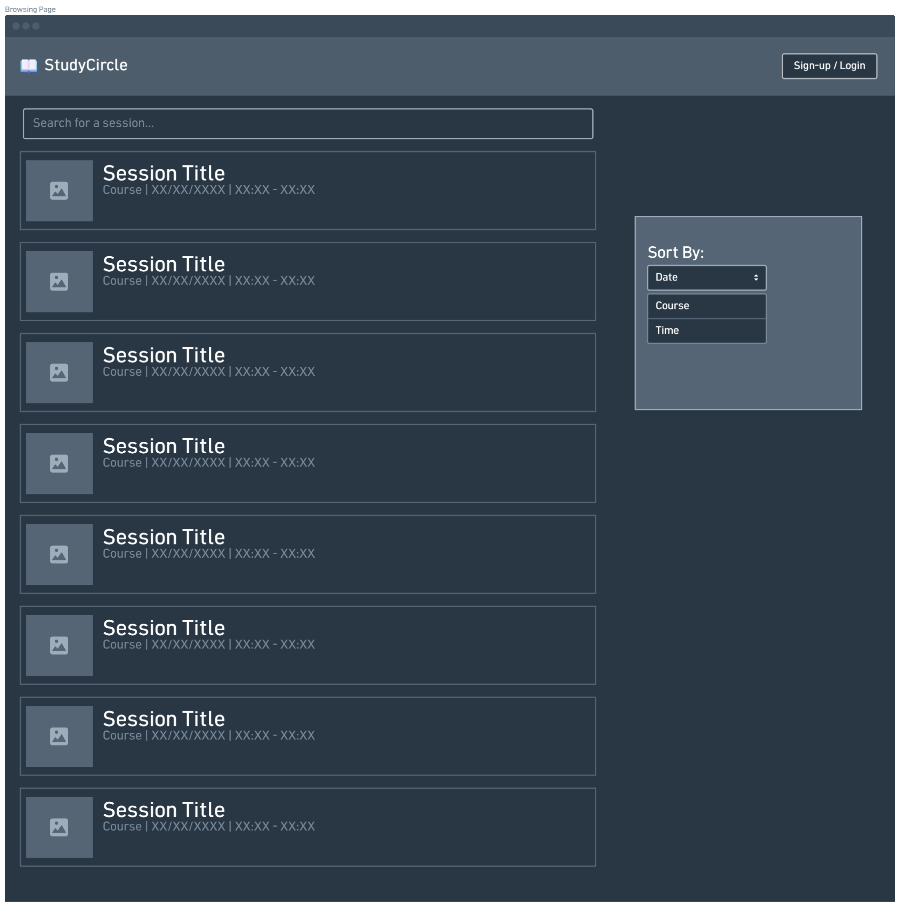
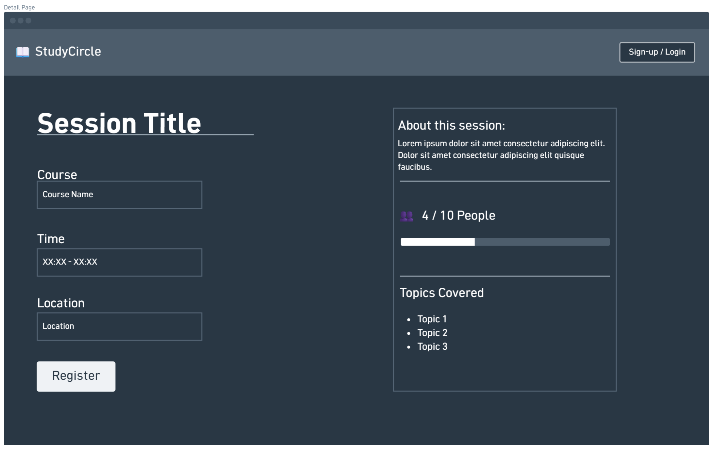

# Wireframes

Reference the Creating an Entity Relationship Diagram final project guide in the course portal for more information about how to complete this deliverable.

## List of Pages

<!-- Logged Out Pages -->
- ⭐ Home/Landing Page
- ⭐ Session Browsing Page
- ⭐ Session Details Page

<!-- Logged In Pages -->
-  Profile Page
-  Session Browsing Page
-  Session Details Page
-  Create Session Page
-  Edit Session Page

## Wireframe 1: Home/Landing Page

## Wireframe 2: Browsing Page

## Wireframe 3: Details Page

[👉🏾👉🏾👉🏾 include more wireframes as desired]
